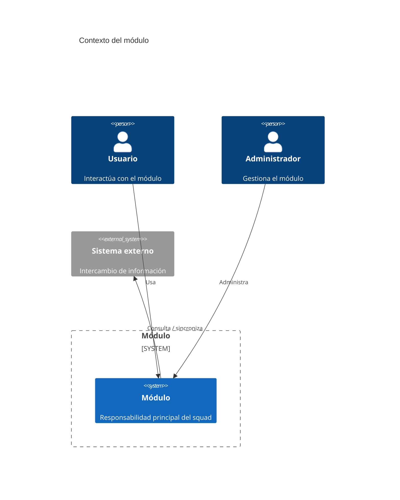

# C4 - Contexto

Usar Mermaid inline con sintaxis `C4Context`.

## Propósito

...

## Sistema analizado

...

## Actores y sistemas externos

| Elemento | Tipo | Interacción |
| --- | --- | --- |
| ... | ... | ... |

## Diagrama

## Notas

- ...
