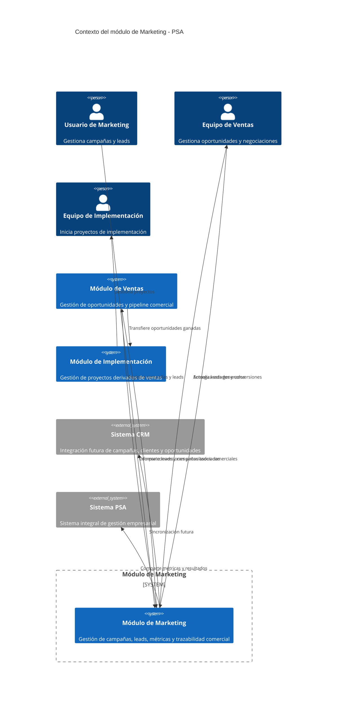

# R5.1 - Diagrama de Contexto (C4)
## Propósito

- Representar el contexto del módulo de Marketing dentro del sistema PSA.
- Identificar actores principales y sistemas externos con los que interactúa.
- Mostrar cómo el módulo se integra en el flujo de generación de oportunidades de negocio.
- Reflejar la relación funcional entre Marketing, Ventas e Implementación dentro del MVP.
- Mostrar la trazabilidad comercial desde campañas hasta oportunidades concretadas.

## Sistema analizado

- Modulo Marketing del sistema de gestión PSA.

## Actores y sistemas externos

| Elemento | Tipo | Interacción |
| --- | --- | --- |
| Usuario de Marketing | Actor | Crea campañas, registra leads y consulta métricas de efectividad |
| Equipo de Ventas | Actor | Contacta leads, los califica y convierte en oportunidades |
| Equipo de Implementación | Actor | Recibe oportunidades ganadas para iniciar proyectos |
| Sistema CRM | Sistema Externo | Futuras integraciones para sincronización de leads y oportunidades |
| Sistema PSA | Sistema Externo | Centraliza información comercial y resultados |
| Módulo de Ventas | Sistema Interno | Gestiona oportunidades y negociaciones derivadas de leads |
| Módulo de Implementación | Sistema Interno | Gestiona proyectos posteriores a oportunidades ganadas |

## Diagrama

