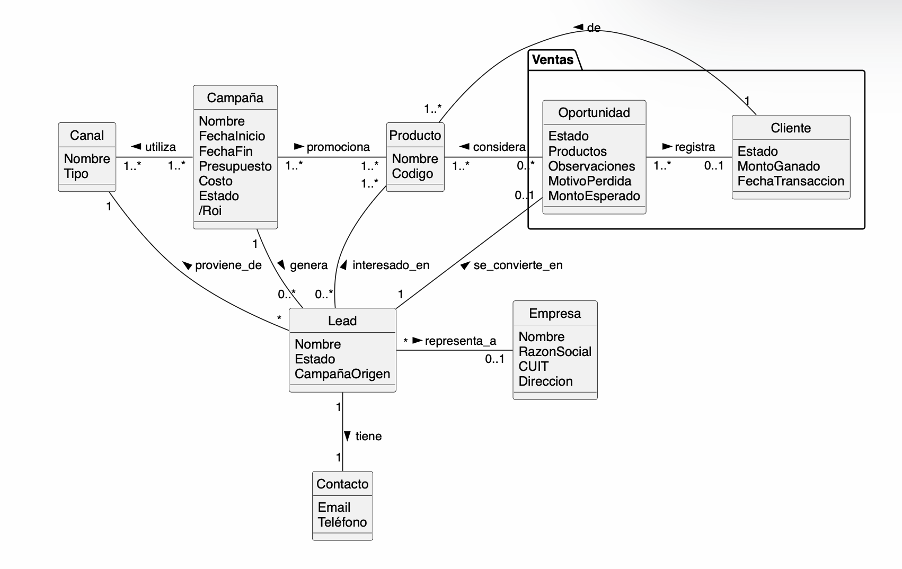

# R5.2 - Modelo de Dominio

## Fuente canónica y companions

- fuente canónica editable: `docs/analisis/modelo-dominio.puml`
- export visual obligatoria: `docs/analisis/modelo-dominio.svg` o `docs/analisis/modelo-dominio.png`
- documento de contexto y trazabilidad: `docs/analisis/modelo-dominio.md`
- no usar `drawio`, Mermaid inline ni una imagen suelta como fuente principal de este artefacto

## Alcance del modelo

- El modelo cubre el módulo de Marketing enfocado en campañas y gestión de leads.

- En esta Iteración 04 se incluye:
  - Registro de campañas con métricas.
  - Registro de leads asociados a una campaña origen.
  - Registro de estado del lead.
  - Gestión del estado del lead.
  - Registro de canal de origen del lead.
  - Registro de empresa y datos de contacto del lead.
  - Asociación entre campañas y productos promocionados.
  - Métricas básicas de campañas (como atributo derivado):
    - `Roi` como atributo derivado (`/Roi`) de `Campaña`
  - Validaciones:
    - campaña obligatoria
    - estado obligatorio en Campaña
    - estado obligatorio en Lead
    - canal de origen obligatorio

- Integración con módulo de Ventas:
  - Lead se convierte en Oportunidad (Ventas::Oportunidad)
  - Oportunidad registra Cliente (Ventas::Cliente)
  - La trazabilidad completa permite calcular métricas de efectividad

- Esto permite trazabilidad completa entre campañas, leads y resultados comerciales.

- Queda fuera:
  - Cálculo avanzado de ROI (modelado como atributo derivado de Campaña).
  - Integraciones externas (CRM, redes).
  - Automatización y IA.
  - Análisis avanzado de métricas.
  - Comparativas automáticas entre campañas.
  - Gestión avanzada de seguridad y permisos.
  - Modelar clase separada de Métrica.

## Inputs usados

- `docs/vision/vision-modulo.md` — **V1** Visión del Módulo (MVP)
- `docs/requisitos/historias-dominio.md` — **R3** Historias de Dominio
- `docs/requisitos/historias-usuario.md` — **R4.1** Historias de Usuario (HU-06, HU-07, HU-21, HU-22, HU-24)
- `docs/requisitos/matriz-trazabilidad.md` — **R4.2** Matriz de Trazabilidad
- `src/test/resources/features/HU-06.feature`
- `src/test/resources/features/HU-07.feature`
- `src/test/resources/features/HU-24.feature`
- `docs/requisitos/especificacion-requisitos.md` — **R4** Especificación de Requisitos
- minuta reunión Marketing y Ventas `07/05/2026`
- Análisis con NotebookLM: Capítulos 9 y 32 de Craig Larman "Applying UML and Patterns"

## Historias priorizadas tomadas como base

| Historia | Recorte que aporta al modelo | Escenarios o evidencia usada |
| --- | --- | --- |
| `HU-06` | Registro de campaña, métricas y asociación con leads | `HU-06.feature`, escenarios de registro de campaña y validaciones |
| `HU-07` | Gestión del estado del lead | `HU-07.feature`, escenarios de estados y validaciones |
| `HU-24` | Asociación campaña → lead | `HU-24.feature` |

## Clases conceptuales

| Clase conceptual | Evidencia visible | Justificación breve |
| --- | --- | --- |
| `Campaña` | `HU-06`, minuta 07/05/2026 | representa una acción de marketing medible |
| `Lead` | `HU-06`, `HU-07`, `HU-24`, minuta 07/05/2026 | entidad central de captación con estado intrínseco |
| `Contacto` | Diccionario de datos, minuta 07/05/2026 | agrupa email y teléfono del lead |
| `Producto` | `HU-06`, minuta 07/05/2026 | elemento promocionado por campañas |
| `Ventas::Oportunidad` | `HU-21`, `HU-23`, minuta 07/05/2026 | estado avanzado de un lead, pertenece al módulo de Ventas |
| `Ventas::Cliente` | `HU-11`, `HU-15`, `HU-20`, `HU-23`, minuta 07/05/2026 | resultado de una oportunidad ganada, pertenece al módulo de Ventas |
| `Canal` | `HU-06`, `HU-07`, `HU-24`, minuta 07/05/2026 | medio por donde se publicita una campaña (gráfico, radio, etc.) |
| `Empresa` | `HU-06`, `HU-07`, `HU-24`, minuta 07/05/2026 | persona jurídica que representa a uno o más leads |

## Asociaciones

| Relación | Multiplicidad | Etiqueta | Evidencia visible |
| --- | --- | --- | --- |
| `Campaña` – `Lead` | 1 a 0..* | `genera` | HU-06, HU-24, minuta |
| `Campaña` – `Producto` | 1 a 1..* | `promociona` | HU-06 |
| `Campaña` – `Canal` | 1..* a 1..* | `utiliza` | HU-06 |
| `Lead` – `Contacto` | 1 a 1 | `tiene` | Diccionario datos, minuta |
| `Lead` – `Producto` | 0..* a 1..* | `interesado_en` | HU-06 |
| `Lead` – `Canal` | * a 1 | `proviene_de` | HU-24, HU-07 |
| `Lead` – `Empresa` | * a 0..1 | `representa_a` | HU-06, HU-07, HU-24 |
| `Lead` – `Ventas::Oportunidad` | 1 a 0..1 | `se_convierte_en` | HU-21, HU-23 |
| `Ventas::Oportunidad` – `Producto` | 0..* a 1..* | `considera` | HU-21, HU-23 |
| `Ventas::Oportunidad` – `Ventas::Cliente` | 1..* a 0..1 | `registra` | HU-11, HU-23 |
| `Ventas::Cliente` – `Producto` | 1 a 1..* | `de` | HU-15, HU-23 |

## Atributos

| Clase | Atributos simples | Atributos derivados | Evidencia visible |
| --- | --- | --- | --- |
| `Campaña` | `Nombre`, `FechaInicio`, `FechaFin`, `Presupuesto`, `Costo`, `Estado` | `Roi` | HU-06, HU-14, HU-08, minuta |
| `Lead` | `Nombre`, `Estado`, `CampañaOrigen` | - | HU-06, HU-07, HU-24, minuta, RF-24, RN-07 |
| `Empresa` | `Nombre`, `RazonSocial`, `CUIT`, `Direccion` | - | HU-06, HU-07, HU-24, minuta |
| `Canal` | `Nombre`, `Tipo` | - | HU-06, HU-07, HU-24, minuta |
| `Contacto` | `Email`, `Teléfono` | - | Diccionario datos, minuta |
| `Producto` | `Nombre`, `Codigo` | - | HU-06 |
| `Ventas::Oportunidad` | `Estado`, `Productos`, `Observaciones`, `MotivoPerdida`, `MontoEsperado` | - | HU-21, HU-23 |
| `Ventas::Cliente` | `Estado`, `MontoGanado`, `FechaTransaccion` | - | HU-11, HU-15, HU-23 |

## Diagrama

## Trazabilidad

| Elemento del modelo | Historias / features | Evidencia adicional |
| --- | --- | --- |
| `Campaña` | `HU-06`, `HU-24` | `HU-06.feature`, `HU-24.feature`, minuta 07/05/2026 |
| `Lead` | `HU-06`, `HU-07`, `HU-21`, `HU-22`, `HU-24` | `HU-06.feature`, `HU-07.feature`, `HU-24.feature`, minuta 07/05/2026, RF-24, RN-07 |
| `Contacto` | `HU-22` | Diccionario datos, minuta 07/05/2026 |
| `Empresa` | `HU-06`, `HU-07`, `HU-24` | `HU-07.feature`, `HU-24.feature`, minuta 07/05/2026 |
| `Producto` | `HU-06`, `HU-13`, `HU-15` | `HU-06.feature` |
| `Canal` | `HU-06`, `HU-07`, `HU-22`, `HU-24` | `HU-22.feature`, minuta 07/05/2026 |
| `Ventas::Oportunidad` | `HU-21`, `HU-23` | `HU-23.feature` |
| `Ventas::Cliente` | `HU-11`, `HU-15`, `HU-20`, `HU-23` | `HU-11.feature`, `HU-23.feature` |

## Fuera de alcance y exclusiones

- no modelar endpoints, controllers, services, repositories, DTOs ni decisiones de arquitectura
- no modelar pantallas, widgets, botones ni navegación de UI
- no convertir esto en modelo ER, esquema SQL ni diagrama de código
- no inventar clases o asociaciones sin evidencia visible en los inputs anteriores

## Dudas abiertas

- Enumeración completa de valores para atributo `estado` en Lead (seguimiento comercial en fases del pipeline)
- Definir canales concretos preconfigurados vs. creación libre por el usuario
- Atributos adicionales requeridos para `Ventas::Oportunidad` y `Ventas::Cliente` (a ser especificados por módulo Ventas)
- Necesidad de modelar historial de cambios de estado del lead (auditabilidad)
- Integración de pagos parciales: ¿Modelar como clase `Pago` separada o atributo de `Ventas::Cliente`?

## Subset permitido de PlantUML

Usar `docs/analisis/modelo-dominio.puml` con un diagrama de clases conceptual al estilo Larman. El subset permitido para este artefacto es:

- `class`
- atributos simples
- atributos derivados (notación `/atributo`)
- asociaciones con multiplicidad y etiqueta
- generalización solo si realmente aclara el dominio
- clase asociativa cuando la relación necesita atributos propios

Queda prohibido:

- métodos u operaciones
- visibilidades (`+`, `-`, `#`, `~`)
- `!include`
- `skinparam`
- interfaces, packages o estereotipos técnicos
- vocabulario de implementación como `Controller`, `Service`, `Repository`, `DTO`, `API`, `endpoint`, `tabla`, `screen` o `UI`