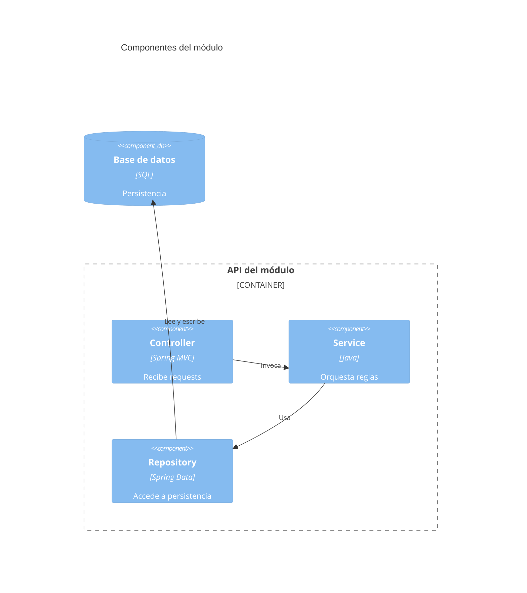

# C4 - Componentes

Usar Mermaid inline con sintaxis `C4Component`.

## Propósito

...

## Componentes principales

| Componente | Responsabilidad | Interacciones |
| --- | --- | --- |
| ... | ... | ... |

## Diagrama

## Riesgos o límites del diseño

- ...
