# D1.2 - Diagrama de Componentes (C4)

## Propósito

Describir la estructura interna del módulo de Marketing a nivel de componentes de código,
mostrando cómo se organizan las responsabilidades dentro del backend Spring Boot
y cómo interactúan entre sí para implementar los flujos de campañas y pipeline de leads.

## Componentes principales

| Componente | Responsabilidad | Interacciones |
| --- | --- | --- |
| `campaniaController` | Recibe requests HTTP para registrar, listar, obtener, actualizar, avanzar estado y consultar métricas de campañas | Delega en `campaniaService` |
| `LeadController` | Recibe requests HTTP para crear, listar, obtener, actualizar, avanzar pipeline, cerrar con resultado y reportar por canal leads | Delega en `LeadService` |
| `ProductoController` | Recibe requests HTTP para listar y obtener productos del catálogo | Delega en `ProductoService` |
| `CanalController` | Recibe requests HTTP para listar y obtener canales del catálogo | Delega en `CanalService` |
| `EmpresaController` | Recibe requests HTTP para listar, obtener y crear empresas | Delega en `EmpresaService` |
| `PingController` | Expone el health check del backend (`GET /api/health`) | Delega en `PingService` |
| `DocsController` | Redirige a Swagger UI (`GET /docs`) | — |
| `campaniaService` | Orquesta el registro y actualización de campañas, valida campos obligatorios, controla la secuencia `Planificada → Activa → Finalizada` y calcula métricas derivadas (incluyendo ROI vía `VentasService`) | Usa `campaniaRepository`, `ProductoRepository`, `CanalRepository`, `LeadComercialRepository`, `VentasService` |
| `LeadService` | Orquesta el ciclo de vida del lead: creación, actualización, canal de origen, avance secuencial en pipeline `Nuevo → Contactado → Calificado → Convertido/Perdido`, cierre con resultado y reporte por canal | Usa `LeadComercialRepository`, `ContactoRepository`, `ProductoRepository`, `CanalRepository`; depende de `campaniaService` para validar campaña activa |
| `ProductoService` | Provee listado y consulta de productos del catálogo | Usa `ProductoRepository` |
| `CanalService` | Provee listado y consulta de canales del catálogo | Usa `CanalRepository` |
| `EmpresaService` | Orquesta el registro y consulta de empresas; evita duplicados por CUIT | Usa `EmpresaRepository` |
| `PingService` | Retorna el estado del backend | Usa `PingRepository` |
| `campaniaRepository` | Accede a la tabla `campania`; soporta búsqueda por estado y por nombre | Lee y escribe en base de datos |
| `LeadComercialRepository` | Accede a la tabla `lead_comercial`; soporta filtros por campaña, canal y etapa, y queries de agrupación por canal | Lee y escribe en base de datos |
| `ProductoRepository` | Accede a la tabla `producto`; resuelve productos por nombre para asociarlos a campañas y leads | Lee y escribe en base de datos |
| `ContactoRepository` | Accede a la tabla `contacto`; persiste los datos de contacto asociados a un lead | Lee y escribe en base de datos |
| `CanalRepository` | Accede a la tabla `canal`; resuelve o crea canales por nombre | Lee y escribe en base de datos |
| `EmpresaRepository` | Accede a la tabla `empresa`; soporta búsqueda por nombre y por CUIT | Lee y escribe en base de datos |
| `PingRepository` | Retorna un mensaje de salud del backend | Responde en memoria |
| `VentasService` | Consulta al módulo de Ventas (Squad 3) para obtener el `montoGanado` de oportunidades asociadas a leads convertidos; usado para el cálculo de ROI | Usa `RestTemplate` para llamar a `GET /api/oportunidades/lead/{leadId}` del backend de Ventas |
| `GlobalExceptionHandler` | Intercepta excepciones de dominio y las traduce a respuestas HTTP con código y mensaje apropiado (`400`, `404`, `422`) | Aplica a todos los controllers vía `@RestControllerAdvice` |

## Trazabilidad historias de usuario

| Historia | Endpoint(s) | Servicio | Archivo .feature |
|---|---|---|---|---|
| HU-06 — Registro y métricas de campañas | POST /api/campanias, GET /api/campanias/{id}/metricas, PUT /api/campanias/{id}, DELETE /api/campanias/{id} | CampaniaService | src/test/resources/features/HU-06.feature |
| HU-07 — Ciclo de vida del lead en pipeline | PATCH /api/leads/{id}/pipeline, PATCH /api/leads/{id}/cierre, GET /api/leads, GET /api/leads/{id} | LeadService | src/test/resources/features/HU-07.feature |
| HU-22 — Registro del canal de origen y actualización de datos | PATCH /api/leads/{id}/canal-origen, GET /api/leads/reporte/por-canal, PUT /api/leads/{id} | LeadService | src/test/resources/features/HU-22.feature |
| HU-24 — Asociación de leads a campañas | POST /api/leads | LeadService | src/test/resources/features/HU-24.feature |
| HU-25 — Consulta de catálogos (productos y canales) | GET /api/productos, GET /api/productos/{id}, GET /api/canales, GET /api/canales/{id} | ProductoService, CanalService | src/test/resources/features/HU-25.feature |
| HU-26 — Gestión de empresas | GET /api/empresas, GET /api/empresas/{id}, POST /api/empresas | EmpresaService | src/test/resources/features/HU-26.feature |

## Diagrama

```mermaid
C4Component
    title Componentes del módulo de Marketing

    Person(usuario, "Responsable de Marketing", "Opera campañas y leads desde el cliente")

    Container_Boundary(api, "Marketing API — Spring Boot") {

        Component(campaniaCtrl, "campaniaController", "Spring MVC", "POST /api/campanias, GET /api/campanias, GET /api/campanias/{id}, PUT /api/campanias/{id}, PATCH /api/campanias/{id}/estado, GET /api/campanias/{id}/metricas")
        Component(leadCtrl, "LeadController", "Spring MVC", "POST /api/leads, GET /api/leads, GET /api/leads/{id}, PUT /api/leads/{id}, PATCH /api/leads/{id}/canal-origen, PATCH /api/leads/{id}/pipeline, PATCH /api/leads/{id}/cierre, GET /api/leads/reporte/por-canal")

        Component(productoCtrl, "ProductoController", "Spring MVC", "GET /api/productos, GET /api/productos/{id}")
        Component(canalCtrl, "CanalController", "Spring MVC", "GET /api/canales, GET /api/canales/{id}")
        Component(empresaCtrl, "EmpresaController", "Spring MVC", "POST /api/empresas, GET /api/empresas, GET /api/empresas/{id}")
        Component(pingCtrl, "PingController", "Spring MVC", "GET /api/health")
        Component(docsCtrl, "DocsController", "Spring MVC", "GET /docs → Swagger UI")

        Component(campaniaService, "campaniaService", "Spring Service", "Valida campos, controla secuencia de estados, actualiza datos, calcula métricas derivadas (ROI incluido)")
        Component(leadService, "LeadService", "Spring Service", "Valida campaña activa, controla pipeline secuencial, gestiona actualización y cierre con resultado obligatorio")
        Component(ventasService, "VentasService", "Spring Service", "Consulta montoGanado al módulo de Ventas vía REST")
        Component(productoService, "ProductoService", "Spring Service", "Listado y consulta de productos del catálogo")
        Component(canalService, "CanalService", "Spring Service", "Listado y consulta de canales del catálogo")
        Component(empresaService, "EmpresaService", "Spring Service", "Registro y consulta de empresas; evita duplicados por CUIT")
        Component(pingService, "PingService", "Spring Service", "Retorna estado del backend")

        Component(campaniaRepo, "campaniaRepository", "Spring Data JPA", "Persistencia de campañas; búsqueda por estado y nombre")
        Component(leadRepo, "LeadComercialRepository", "Spring Data JPA", "Persistencia de leads; filtros por campaña, canal, etapa y agrupación por canal")
        Component(productoRepo, "ProductoRepository", "Spring Data JPA", "Persistencia de productos; resolución por nombre")
        Component(contactoRepo, "ContactoRepository", "Spring Data JPA", "Persistencia de datos de contacto del lead")
        Component(canalRepo, "CanalRepository", "Spring Data JPA", "Persistencia de canales; resolución por nombre")
        Component(empresaRepo, "EmpresaRepository", "Spring Data JPA", "Persistencia de empresas; búsqueda por nombre y CUIT")
        Component(pingRepo, "PingRepository", "In-memory", "Retorna mensaje de salud del backend")

        Component(exHandler, "GlobalExceptionHandler", "Spring RestControllerAdvice", "Traduce excepciones de dominio a respuestas HTTP 400/404/422")
    }

    System_Ext(ventasBackend, "Backend de Ventas (Squad 3)", "API REST - Oportunidades y clientes")

    ComponentDb(db, "Base de datos", "PostgreSQL / H2 (tests)", "Tablas: campania, lead_comercial, contacto, producto, canal, campania_producto, campania_canal, lead_producto")

    Rel(usuario, campaniaCtrl, "HTTP requests", "REST/JSON")
    Rel(usuario, leadCtrl, "HTTP requests", "REST/JSON")
    Rel(usuario, productoCtrl, "HTTP requests", "REST/JSON")
    Rel(usuario, canalCtrl, "HTTP requests", "REST/JSON")
    Rel(usuario, empresaCtrl, "HTTP requests", "REST/JSON")
    Rel(usuario, pingCtrl, "HTTP requests", "REST/JSON")
    Rel(usuario, docsCtrl, "HTTP redirect", "302")

    Rel(campaniaCtrl, campaniaService, "Invoca")
    Rel(leadCtrl, leadService, "Invoca")
    Rel(productoCtrl, productoService, "Invoca")
    Rel(canalCtrl, canalService, "Invoca")
    Rel(empresaCtrl, empresaService, "Invoca")
    Rel(pingCtrl, pingService, "Invoca")

    Rel(campaniaService, campaniaRepo, "Usa")
    Rel(campaniaService, productoRepo, "Usa")
    Rel(campaniaService, canalRepo, "Valida canales")
    Rel(campaniaService, leadRepo, "Consulta para métricas")
    Rel(campaniaService, ventasService, "Consulta montoGanado para ROI")
    Rel(ventasService, ventasBackend, "HTTP GET /api/oportunidades/lead/{leadId}")

    Rel(leadService, leadRepo, "Usa")
    Rel(leadService, contactoRepo, "Usa")
    Rel(leadService, productoRepo, "Usa")
    Rel(leadService, canalRepo, "Resuelve canal")
    Rel(leadService, campaniaService, "Valida campaña activa")
    Rel(productoService, productoRepo, "Usa")
    Rel(canalService, canalRepo, "Usa")
    Rel(empresaService, empresaRepo, "Usa")
    Rel(pingService, pingRepo, "Usa")

    Rel(campaniaRepo, db, "Lee y escribe")
    Rel(leadRepo, db, "Lee y escribe")
    Rel(productoRepo, db, "Lee y escribe")
    Rel(contactoRepo, db, "Lee y escribe")
    Rel(canalRepo, db, "Lee y escribe")
    Rel(empresaRepo, db, "Lee y escribe")

    Rel(exHandler, campaniaCtrl, "Intercepta excepciones")
    Rel(exHandler, leadCtrl, "Intercepta excepciones")
    Rel(exHandler, productoCtrl, "Intercepta excepciones")
    Rel(exHandler, canalCtrl, "Intercepta excepciones")
    Rel(exHandler, empresaCtrl, "Intercepta excepciones")
    Rel(exHandler, pingCtrl, "Intercepta excepciones")
```

## Riesgos o límites del diseño

- **Acoplamiento `LeadService → campaniaService`**: `LeadService` depende directamente de `campaniaService` para validar si una campaña está activa. Si el módulo de Campañas crece en complejidad, esta dependencia podría convertirse en un cuello de botella. Alternativa futura: un puerto/interfaz `campaniaConsultaPort`.
- **Métricas calculadas en tiempo real**: `GET /api/campanias/{id}/metricas` recorre todos los leads de la campaña en cada request. Con volúmenes altos esto degrada. Por ahora es aceptable en el MVP; en iteraciones siguientes se puede materializar el cálculo.
- **Sin autenticación ni control de roles**: todos los endpoints son públicos. La restricción de quién puede acceder a `/api/leads/reporte/por-canal` (mencionada como decisión abierta en `api-modulo.md`) queda pendiente para una iteración futura.
- **`Oportunidad` fuera de alcance**: el módulo genera el lead hasta `Convertido`, pero la creación de la `Ventas::Oportunidad` al cerrar como `Ganado` no está implementada. Queda como punto de integración explícito con el módulo de Ventas.
- **Consulta síncrona a Ventas para ROI**: el cálculo de ROI en `GET /api/campanias/{id}/metricas` hace una llamada HTTP síncrona a Ventas por cada lead convertido. Si Ventas no responde, el monto se reporta como 0. A futuro podría cachearse o hacerse asíncrono.