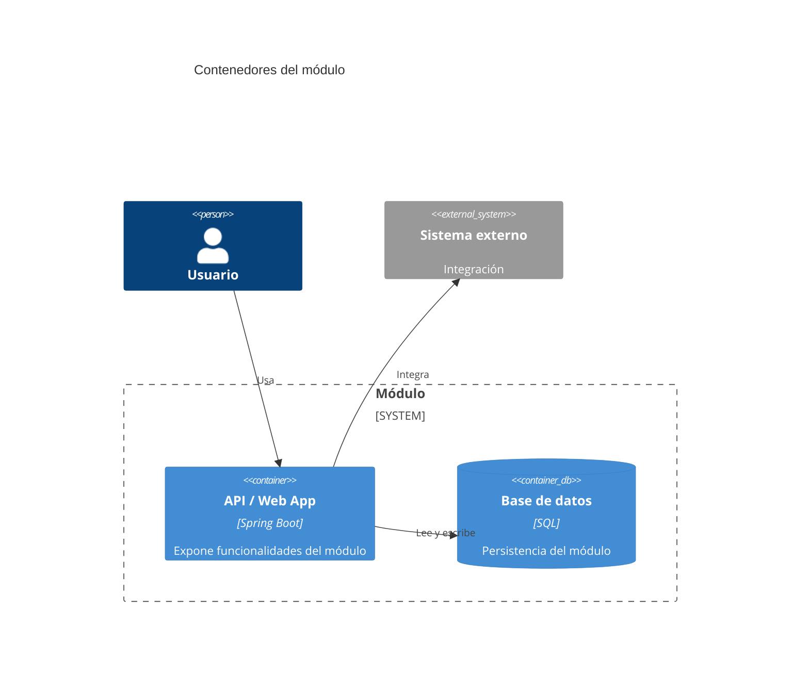

# C4 - Contenedores

Usar Mermaid inline con sintaxis `C4Container`.

## Propósito

...

## Contenedores

| Contenedor | Responsabilidad | Tecnología |
| --- | --- | --- |
| ... | ... | ... |

## Diagrama

## Decisiones relevantes

- ...
