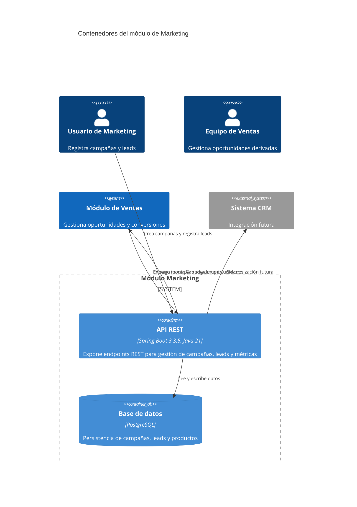

# D1.1 - Diagrama de Contenedores (C4)

Usar Mermaid inline con sintaxis `C4Container`.

## Propósito

Descomponer el módulo de Marketing en sus contenedores técnicos, mostrando cómo interactúan los componentes que soportan la gestión de campañas, leads y métricas con trazabilidad de origen.

## Contenedores

| Contenedor | Responsabilidad | Tecnología |
| --- | --- | --- |
| API REST Marketing | Expone endpoints para gestión de campañas y leads | Spring Boot 3.3.5, Java 21 |
| Base de datos | Persiste entidades de dominio (Campaña, Lead, Producto, Canal, Contacto) | PostgreSQL |
| Módulo de Ventas | Consume leads generados y reporta conversiones | Sistema PSA interno |

## Diagrama

## Decisiones relevantes

- Framework: Spring Boot 3.3.5 con Java 21: Confirmado en build.gradle. Alineado con stack empresarial para consistencia arquitectónica.
- API REST: Confirmado por dependencia spring-boot-starter-web en build.gradle. Permite integración futura con módulos PSA internos (Ventas) y sistemas externos (CRM).
- Base de datos: PostgreSQL
- Separación de responsabilidades: API y BD como contenedores distintos siguiendo patrón arquitectónico de capas, coherente con la estructura actual (controller, service, repository en src/main/java).
- Testing con Cucumber.
