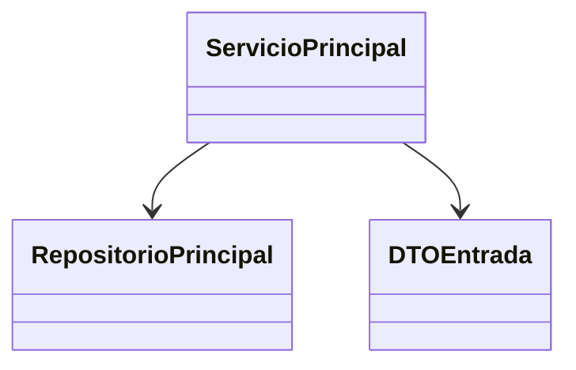

# Diagrama de código

Usar este artefacto solo si la complejidad real del módulo justifica explicarlo.

Usar Mermaid inline. Si alcanza, priorizar `classDiagram`; si no, elegir el tipo Mermaid que mejor explique el recorte.

## Motivo del diagrama

...

## Recorte aplicado

...

## Diagrama

## Lectura recomendada

- ...
