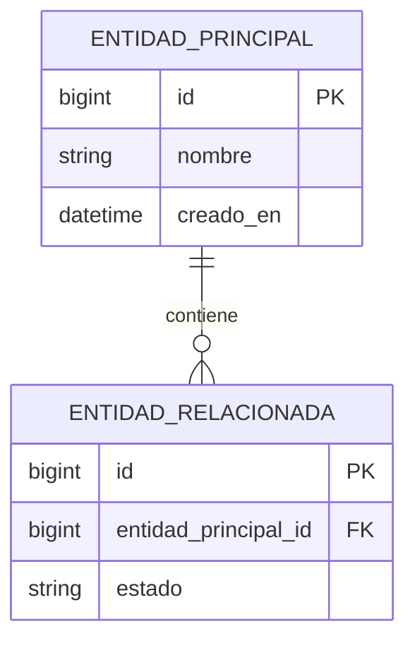

# Modelo ER

Usar Mermaid inline con sintaxis `erDiagram`.

## Alcance del modelo

...

## Supuestos de persistencia

- ...

## Entidades y relaciones

## Reglas relevantes de datos

| Regla | Impacto en el esquema |
| --- | --- |
| ... | ... |

## Decisiones pendientes

- ...
