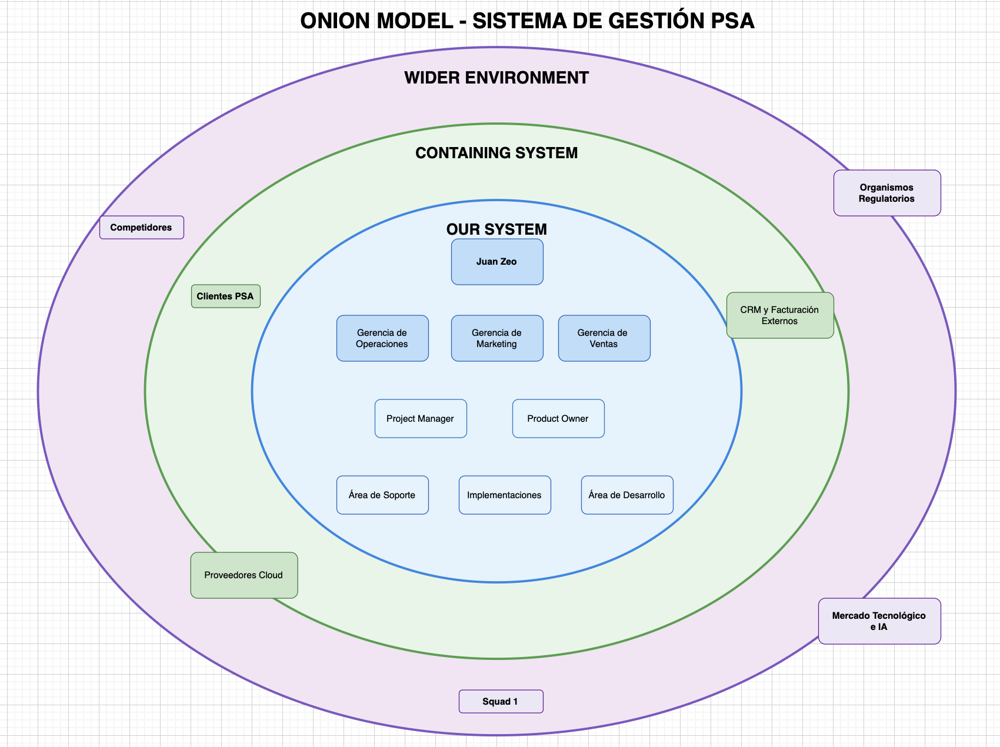

# R1.2 - Onion Model

## Sistema analizado

- Sistema integral de gestión PSA (en construcción).
- Plataforma orientada a integrar:
  - Proyectos
  - Implementaciones
  - Soporte e Incidentes
  - Marketing
  - Ventas / CRM
  - Horas y Rentabilidad
  - Infraestructura

## Criterio de capas

- `Our System`
  - Incluye a los usuarios internos y áreas que operan directamente el sistema PSA en su trabajo diario.

- `Containing System`
  - Incluye actores externos o semiexternos que interactúan directamente con PSA y sus procesos.

- `Wider Environment`
  - Incluye regulaciones, competencia, tendencias tecnológicas y factores de mercado que impactan indirectamente sobre el sistema y sus decisiones estratégicas.

## Resumen del modelo

- El Onion Model representa los principales interesados vinculados al sistema integral de PSA.
- El sistema busca centralizar información actualmente fragmentada entre múltiples áreas operativas y comerciales.
- El objetivo organizacional principal es:
  - mejorar la eficiencia operativa,
  - aumentar captación de clientes,
  - mejorar trazabilidad comercial,
  - incrementar ROI,
  - y reducir fricciones entre áreas.

## Registro de interesados

| ID | Interesado | Capa | Relación con el sistema | Justificación | Estado |
| --- | --- | --- | --- | --- | --- |
| I-01 | Juan Zeo | Our System | CEO y dirección estratégica | Define objetivos del sistema y criterios de éxito | explícito |
| I-02 | Fernando Zoluzzia | Our System | Gerencia de Operaciones | Responsable de proyectos, soporte e implementaciones | explícito |
| I-03 | Ricardo Ratio | Our System | Gerencia de Administración y Finanzas | Gestión financiera, costos y facturación | explícito |
| I-04 | Juan Anvizzio | Our System | Gerencia de Ventas | Responsable de oportunidades y pipeline comercial | explícito |
| I-05 | José Mercado | Our System | Gerencia de Marketing | Responsable de campañas, leads y ROI | explícito |
| I-06 | Leonardo Felici | Our System | Project Manager | Coordinación transversal de proyectos | explícito |
| I-07 | Tomás Bruneleschi | Our System | Product Owner | Priorización funcional y definición de producto | explícito |
| I-08 | Maximiliano | Our System | Jefatura de Proyecto | Seguimiento operativo y coordinación | explícito |
| I-09 | Área de Desarrollo | Our System | Desarrollo de productos y funcionalidades | Utilizan información centralizada de proyectos e incidentes | explícito |
| I-10 | Área de Soporte | Our System | Gestión de tickets, SLA e incidentes | Necesitan trazabilidad y centralización | explícito |
| I-11 | Área de Implementaciones | Our System | Gestión de proyectos por cliente | Requieren continuidad desde ventas | explícito |
| I-12 | Área de Marketing | Our System | Gestión de campañas y leads | Utilizan métricas y trazabilidad comercial | explícito |
| I-13 | Área Comercial / Ventas | Our System | Gestión de oportunidades y negociaciones | Responsable del pipeline comercial | explícito |
| I-14 | Área de Infraestructura | Our System | Operación cloud y plataformas | Soporte técnico e infraestructura | explícito |
| I-15 | Squad 1 | Our System | Equipo de análisis y desarrollo | Responsable del relevamiento y construcción inicial | explícito |
| I-16 | Clientes PSA | Containing System | Usuarios y consumidores de productos PSA | Interactúan con soporte, ventas e implementaciones | explícito |
| I-17 | Consultora funcional (Belén Sappe) | Containing System | Consultoría especializada | Apoyo funcional y análisis de necesidades | implícito |
| I-18 | Proveedores cloud y tecnológicos | Containing System | Infraestructura y herramientas | Proveen servicios tecnológicos externos | implícito |
| I-19 | Sistemas CRM y facturación externos | Containing System | Integraciones futuras | Intercambio de datos comerciales y financieros | explícito |
| I-20 | Competidores | Wider Environment | Competencia de mercado | Influyen en estrategia e innovación | implícito |
| I-21 | Organismos regulatorios | Wider Environment | Regulaciones legales e impositivas | Condicionan requisitos del sistema | implícito |
| I-22 | Mercado tecnológico e IA | Wider Environment | Tendencias tecnológicas | Impactan diferenciación competitiva | explícito |
| I-23 | Clientes potenciales | Wider Environment | Oportunidades comerciales futuras | Objetivo de captación y crecimiento | implícito |

## Cobertura faltante

- Identificar stakeholders negativos internos o externos.
- Profundizar impacto de IA y automatización sobre el negocio.
- Identificar futuras integraciones externas relevantes.
- Validar participación operativa real de algunos niveles gerenciales en el sistema.

## Próximas acciones

- Continuar entrevistas con responsables funcionales.
- Refinar expectativas y necesidades de cada área.
- Validar métricas estratégicas y comerciales prioritarias.
- Profundizar integración entre Marketing, Ventas e Implementaciones.
- Identificar riesgos asociados a escalaciones, SLA y coordinación entre áreas.

## Dudas

- Nivel de participación operativa de las gerencias dentro del sistema.
- Alcance real de automatizaciones futuras.
- Nivel de integración esperado con CRM y herramientas externas.
- Cómo impactará IA sobre procesos comerciales y operativos.
- Qué stakeholders externos pueden transformarse en actores críticos a futuro.  