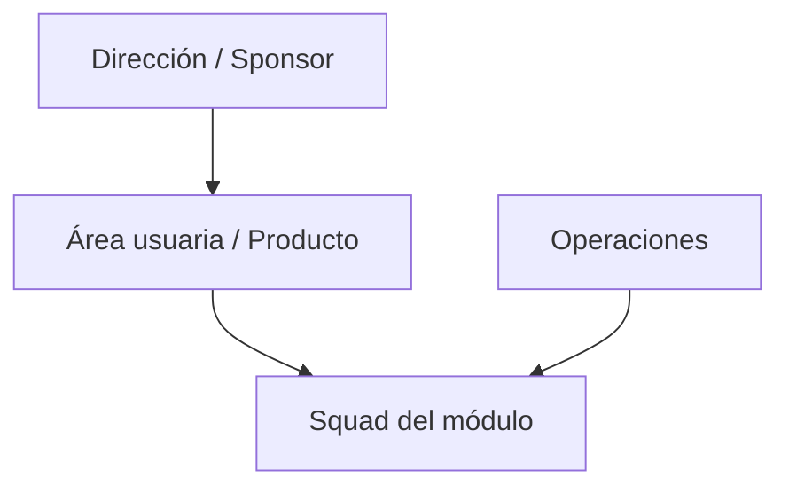

# Organigrama

Usar Mermaid inline dentro de este archivo. Para organigrama, priorizar `flowchart` o `graph`.

## Sistema analizado

...

## Alcance organizacional

...

## Roles y áreas relevantes

| ID | Área o rol | Relación con el módulo | Evidencia |
| --- | --- | --- | --- |
| O-01 | ... | ... | ... |

## Diagrama

## Observaciones

- ...
