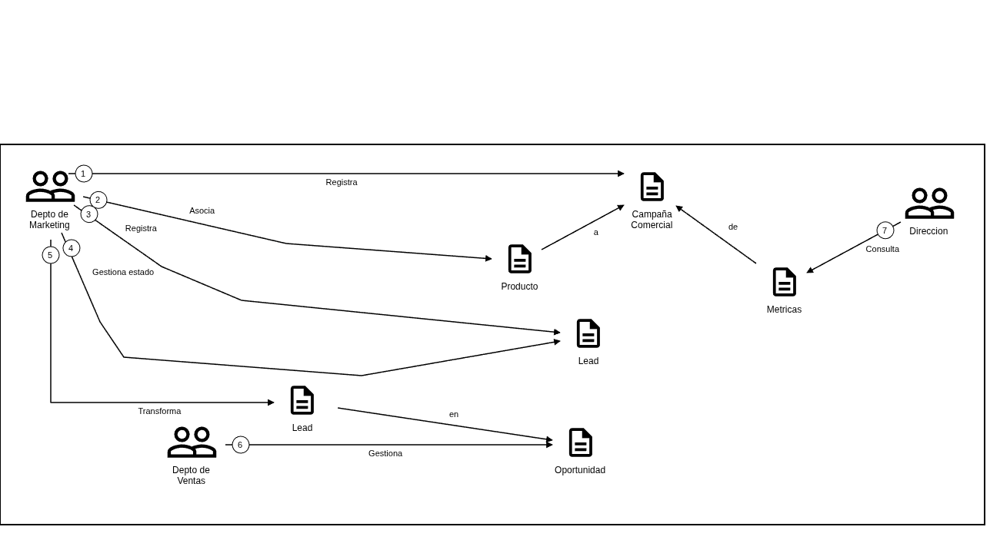

# R3 - Historias de Dominio

## Propósito

El dominio del módulo de Marketing describe la problemática de una organización donde las áreas comerciales operan de forma desacoplada, con baja trazabilidad entre campañas, leads y resultados de negocio.

El objetivo del modelo de dominio es:

- Centralizar la gestión de campañas y la generación de leads.
- Establecer trazabilidad entre campañas, leads y resultados comerciales.
- Proveer métricas básicas de efectividad (ROI, conversión, leads por campaña).
- Reducir la fricción en la transferencia de información entre Marketing y Ventas.
- Permitir decisiones basadas en datos sobre el rendimiento de las acciones de marketing.

## Criterio de recorte

### Incluido en el MVP

- Gestión de campañas de Marketing (registro, estados, métricas básicas).
- Registro de leads asociados a una campaña origen.
- Identificación del canal de origen de cada lead.
- Registro de empresa (como entidad separada con Nombre, RazonSocial, CUIT y Direccion) y datos de contacto del lead.
- Seguimiento básico del estado del lead (Nuevo → Contactado → Calificado → Convertido en Oportunidad / Perdido).
- Métricas básicas:
  - ROI por campaña.
  - Leads por campaña.
  - Tasa de conversión de leads.
  - Efectividad de campañas.
- Trazabilidad hacia el módulo de Ventas: el lead convertido origina una `Ventas::Oportunidad`, pero su gestión posterior es responsabilidad del módulo de Ventas.

### Fuera del alcance de este módulo

- Gestión del pipeline comercial de Ventas (etapas de negociación, cierre de oportunidades).
- Integración con el módulo de Implementaciones (se activa cuando Ventas marca una oportunidad como ganada; no es responsabilidad de Marketing).
- Automatización avanzada de marketing.
- Scoring predictivo de leads.
- Integraciones complejas con CRM externos.
- Alertas automáticas.
- Seguridad y permisos avanzados.
- Analítica avanzada e IA aplicada al marketing.

## Actores y objetos de trabajo

### Actores

| Actor | Rol en el dominio |
| --- | --- |
| Responsable de Marketing | Crea y gestiona campañas; registra leads y su canal de origen |
| Ejecutivo de Ventas | Recibe leads convertidos; gestiona el pipeline (fuera del alcance de este módulo) |
| Dirección | Consulta métricas consolidadas de efectividad comercial |

### Objetos de trabajo

| Objeto | Descripción | Propietario |
| --- | --- | --- |
| `Campaña` | Acción de marketing con presupuesto, fechas, estado y productos asociados | Marketing |
| `Lead` | Prospecto generado por una campaña, con empresa (entidad `Empresa`), contacto, canal y estado | Marketing |
| `Empresa` | Persona jurídica asociada a uno o más leads, con Nombre, RazonSocial, CUIT y Direccion | Marketing |
| `Contacto` | Datos de contacto del lead (email, teléfono, dirección) | Marketing |
| `Producto` | Elemento promocionado por una campaña o de interés para un lead | Compartido |
| `Ventas::Oportunidad` | Estado avanzado de un lead; su gestión pertenece al módulo de Ventas | Ventas |
| `Ventas::Cliente` | Transacción comercial exitosa; pertenece al módulo de Ventas | Ventas |

## Fuente del diagrama

- Archivo editable (Egon): `docs/requisitos/historias-dominio.egn` — **R3** Historias de Dominio
- Imagen exportada: `docs/requisitos/historias-dominio.png` — **R3** Historias de Dominio

## Exportación visual

## Historias relevadas

### Historia 1: Gestión de campañas de marketing

- **Actores:** Responsable de Marketing, Dirección
- **Disparador:** Marketing inicia una nueva campaña comercial.
- **Necesidad / tensión:** No existe centralización de campañas ni trazabilidad de resultados.
- **Resultado esperado:** El sistema registra campañas y permite medir su efectividad comercial.
- **Reglas / restricciones:**
  - Toda campaña debe tener: nombre, estado, canal, costos asociados y al menos un producto.
  - Estados permitidos: Planificada, Activa, Finalizada.
  - No se puede registrar una campaña sin presupuesto definido.

### Historia 2: Generación y registro de leads desde campañas

- **Actores:** Responsable de Marketing
- **Disparador:** Una campaña activa genera nuevos prospectos.
- **Necesidad / tensión:** Falta de trazabilidad entre acciones de marketing y oportunidades comerciales generadas.
- **Resultado esperado:** Cada lead queda vinculado a su campaña de origen y canal, permitiendo medir el impacto de cada acción.
- **Reglas / restricciones:**
  - Todo lead debe registrar: campaña origen, empresa, canal de origen y estado inicial.
  - No se permite registrar un lead sin campaña asociada ni sin canal de origen.
  - El estado inicial de todo lead es "Nuevo".

### Historia 3: Seguimiento del estado del lead

- **Actores:** Responsable de Marketing, Ejecutivo de Ventas
- **Disparador:** Un lead generado por una campaña necesita ser calificado y derivado al equipo comercial.
- **Necesidad / tensión:** El seguimiento de prospectos es informal y sin visibilidad clara del avance; tampoco existe un punto de traspaso definido entre Marketing y Ventas.
- **Resultado esperado:** Los leads avanzan por estados definidos de forma trazable. Marketing califica el lead hasta su conversión; Ventas lo trabaja en su propio pipeline hasta el cierre.
- **Reglas / restricciones:**
  - **Vista de Marketing** — estados de calificación del lead (HU-21, HU-22, HU-24, minuta 07/05/2026):
    - Nuevo → Contactado → Calificado → Convertido en oportunidad/perdido.
    - El avance es secuencial; no se permiten saltos.
    - "Convertido en oportunidad" es el estado terminal en Marketing: origina una `Ventas::Oportunidad` y el lead pasa al módulo de Ventas.
  - **Vista de Ventas** — etapas del pipeline comercial (HU-07):
    - Contacto → Análisis → Consultoría → Demo → Presupuesto → Cierre.
    - El avance también es secuencial; no se permiten saltos de etapa.
    - El cierre puede resultar en Ganado o Perdido; no se permite cerrar sin definir resultado.
    - Esta secuencia es responsabilidad del módulo de Ventas; se documenta aquí para dejar trazabilidad del flujo completo.
  - La atribución de campaña origen se conserva durante todo el ciclo, en ambas vistas.

### Historia 4: Medición de ROI y efectividad de campañas

- **Actores:** Responsable de Marketing, Dirección
- **Disparador:** Finalización de una campaña o necesidad de evaluación de resultados.
- **Necesidad / tensión:** No existen métricas claras sobre el retorno de inversión ni la efectividad de las campañas.
- **Resultado esperado:** El sistema permite calcular y consultar métricas básicas de rendimiento a partir de los datos registrados.
- **Reglas / restricciones:**
  - El ROI considera: costos de campaña e ingresos asociados a ventas generadas (aportados por Ventas).
  - No se contemplan costos internos del equipo.
  - Toda campaña debe poder relacionarse con los leads y oportunidades que generó.
  - Métricas esperadas: ROI, leads por campaña, tasa de conversión, efectividad de campañas.

## Relación con requisitos posteriores

### Historias de usuario derivadas

| Historia de usuario | Relación |
| --- | --- |
| HU-06 | Registro de campaña con indicadores clave, actualización y eliminación |
| HU-07 | Gestión del pipeline del lead y consulta de leads (listado/detalle) |
| HU-08 | Cálculo de ROI por campaña |
| HU-14 | Visualización de métricas de efectividad |
| HU-21 | Gestión del pipeline del lead (etapas secuenciales)|
| HU-22 | Registro de canal de origen del lead y actualización de datos del lead |
| HU-24 | Asociación campaña → lead |
| HU-25 | Consulta de catálogos de productos y canales |
| HU-26 | Gestión de empresas (listado, detalle, creación) |

### Escenarios Gherkin cubiertos

- Registro de campaña, actualización y eliminación con validaciones (`HU-06.feature`).
- Progresión secuencial de etapas del lead y consulta de leads (`HU-07.feature`).
- Creación de lead, atribución de canal de origen y actualización de datos (`HU-22.feature`).
- Asociación campaña → lead con campos obligatorios (`HU-24.feature`).
- Consulta de productos y canales como catálogos (`HU-25.feature`).
- Gestión de empresas con listado, detalle y creación (`HU-26.feature`).
- Gestión de oportunidad (`HU-21.feature`).

### Reglas de negocio derivadas

- Todo lead debe tener campaña origen (RN-07).
- Todo lead debe registrar canal de origen (RN-07).
- El flujo de estados del lead es secuencial y no permite saltos.
- Las campañas deben registrar métricas de efectividad (RN-04).
- La atribución de campaña origen se conserva durante todo el ciclo.

## Dudas abiertas

- ¿Se debe modelar un historial de cambios de estado del lead para auditoría?