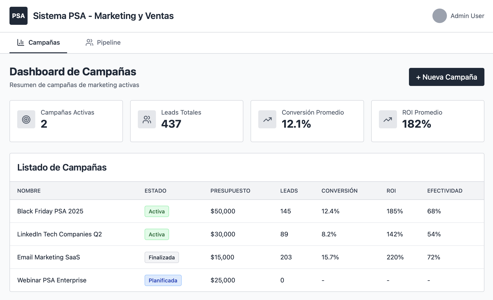
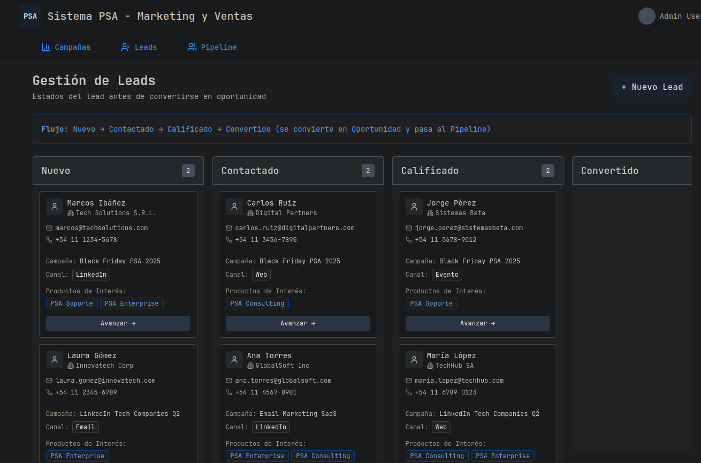
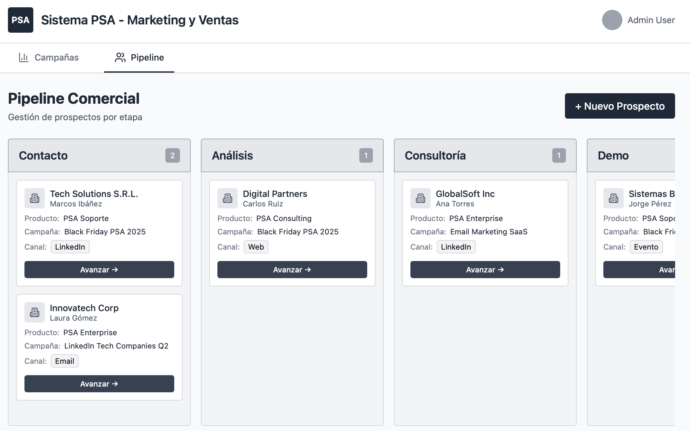

# R5.3 - Prototipos de IU

## Objetivo del prototipo

Validar el flujo principal del módulo de Marketing del sistema PSA, enfocado en:

- registro de campañas de marketing
- asociación de leads a campañas
- gestión básica de leads generados por campañas
- seguimiento de información de campañas
- Seguimiento de oportunidades

Los prototipos buscan representar el comportamiento definido en las historias de usuario relacionadas al módulo de Marketing, incluyendo validaciones y trazabilidad de leads.

## Pantallas o recorridos cubiertos

- Registro de campaña de marketing
- Registro de lead asociado a campaña
- Validaciones obligatorias:
  - campaña origen
  - canal origen
  - estado inicial
  - métricas de campaña
- Visualización de leads registrados
- Actualización del estado del lead
- Seguimiento de oportunidades

## Link read-only

- [Módulo Marketing prototipo](https://www.figma.com/make/2NWtlFYGziGRqNuep5WSe9/Modulo-Marketing-prototipo?t=YNWwCTiUwjyEaSc8-1&preview-route=%2Fpipeline)

## Evidencia exportada

### Dashboard de Campañas

### Gestion de nuevos lead hacia oportunidad

### Gestión de Leads en el pipeline Comercial

## Trazabilidad con requisitos

| Pantalla / Recorrido | HU | RF / RN |
|---|---|---|
| Registro de campaña de marketing | HU-06 | RF-05, RN-04 |
| Registro de lead asociado a campaña | HU-22, HU-24 | RF-05, RF-24, RN-07 |
| Validaciones obligatorias (campaña origen, canal, estado) | HU-06, HU-22, HU-24 | RF-05, RF-24, RN-07 |
| Visualización de leads registrados | HU-07, HU-21 | RF-06, RF-23 |
| Actualización del estado del lead | HU-07, HU-21 | RF-06, RF-23 |
| Seguimiento de oportunidades | HU-21 | RF-23 |
| Consulta de productos y canales disponibles | HU-25 | RF-05, RF-24 |
| Gestión de datos de empresas | HU-26 | RF-05, RF-24 |

## Decisiones de UX visibles

- Formularios simples y centrados en carga rápida de información.
- Uso de listas desplegables para evitar errores de carga en:
  - canal de origen
  - estado del lead
  - producto asociado
- Validaciones visibles en línea mediante mensajes de error claros.
- Representación visual simple de leads asociados a campañas para facilitar seguimiento.
- Navegación mínima entre pantallas para priorizar trazabilidad y simplicidad operativa.
- Diseño responsive considerado como parte de RNF-01.
- Consistencia terminológica con las historias de usuario y features BDD.
